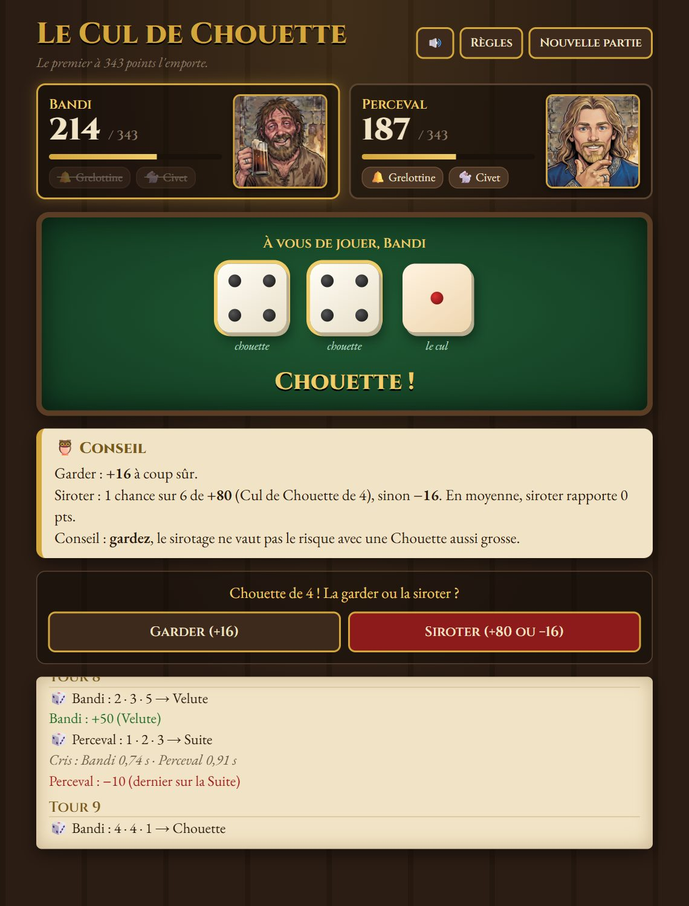

# Le Cul de Chouette

Le jeu de dés de *Kaamelott*, dans votre navigateur. Affrontez Karadoc, Arthur ou Perceval, ou défiez un ami en ligne.

### ▶ [Jouer maintenant](https://banddilondon.github.io/Le-cul-de-chouette/)

Rien à installer, rien à créer : la page s'ouvre et on joue, sur ordinateur comme sur téléphone.



## Comment jouer

On lance les deux **chouettes**, puis le **cul**. Le premier à atteindre **343 points** gagne. Avec la règle des *343 pile*, ce qui dépasse fait reculer : à 340, gagner 5 points ramène à 338.

| Combinaison | Exemple | Ce qui se passe |
|---|---|---|
| **Chouette** | 4 · 4 · 1 | Le carré de la paire : 16 pts. On peut la *siroter*. |
| **Velute** | 2 · 3 · 5 | Deux dés font le troisième : 2 × 5² = 50 pts. |
| **Chouette-Velute** | 3 · 3 · 6 | Tout le monde crie « Pas mou le caillou ! » : le premier empoche la Velute. |
| **Cul de Chouette** | 5 · 5 · 5 | 40 + 10 × la valeur : 90 pts. |
| **Suite** | 3 · 4 · 5 | Tout le monde crie « Grelotte ça picote ! » : le dernier perd 10 pts. |
| **Néant** | 1 · 3 · 6 | Rien… mais on reçoit une Grelottine. |

Et pour pimenter :

- **Le Sirotage** : sur une Chouette, relancez le dé seul pour tenter le Cul de Chouette. Raté, vous perdez la Chouette. Pendant ce temps, l'adversaire parie sur le dé en criant un oiseau (Linotte, Alouette, Fauvette, Mouette, Bergeronnette, Chouette).
- **La Grelottine** : gagnée sur un Néant, elle sert à défier l'adversaire avant son lancer, en misant des points.
- **Le Civet** : une fois par partie, pariez jusqu'à 102 points sur la combinaison que vous allez faire.
- **La Bévue** : pousser le mauvais cri coûte 10 points.
- **Le dé hors du tapis** : avant chaque lancer, arrêtez la jauge dans la zone verte. Trop mou ou trop fort, un dé sort du tapis : 10 points de pénalité, et on relance.

Pas envie de lire ? Le **tutoriel** vous apprend tout en jouant.

## Ce qu'il y a dans le jeu

**Trois adversaires**, chacun avec son style :

| | Réflexes | Jeu |
|---|---|---|
| **Karadoc** | lents | au petit bonheur |
| **Arthur** | honnêtes | raisonnable |
| **Perceval** | redoutables | le spécialiste, il calcule tout |

**Pour apprendre**
- Un **tutoriel** dont les premiers lancers sont arrangés pour montrer chaque règle, une par une.
- Des **conseils** à chaque décision : les chances, le gain moyen de chaque option, et ce qu'il vaut mieux faire.
- Des **réflexes expliqués** : la première fois, on vous dit quoi crier et pourquoi, puis un compte à rebours ; après chaque duel, le bilan avec les temps de chacun.

**À deux en ligne**
- Un joueur crée la partie et envoie le code ou le lien d'invitation ; l'autre le rejoint. Chacun joue sur son appareil.
- Les deux écrans voient exactement les mêmes dés, et les réflexes restent justes malgré le décalage du réseau.
- Revanches à volonté, le premier joueur alternant à chaque manche.

**L'ambiance**
- Des **portraits** pour les adversaires, et six au choix pour vous.
- Des **sons** pour chaque moment : dés qui roulent, hululement de la Chouette, fanfare du Cul de Chouette, poing sur la table…
- Des **cris prononcés** par la voix du navigateur. Les meilleures voix françaises sont dans **Microsoft Edge** (« Denise », « Henri »…).
- **Vos propres cris** : enregistrez-les au micro, pour vous et pour votre adversaire. Ils remplacent la voix de synthèse.

## Jouer sans Internet

Téléchargez le dépôt (**Code › Download ZIP**), décompressez-le et ouvrez `index.html`. Tout fonctionne, sauf le jeu en ligne. Sans connexion, le texte s'affiche simplement dans une police de secours.

## Vie privée

Il n'y a ni compte, ni serveur de jeu, ni statistiques.

- Vos réglages et vos cris enregistrés restent **dans votre navigateur**. Ils ne sont envoyés nulle part.
- En ligne, les deux navigateurs se parlent **directement**. Le service gratuit [PeerJS](https://peerjs.com/) sert seulement à les mettre en relation au début de la partie.

## Sous le capot

Du HTML, du CSS et du JavaScript, sans framework ni étape de compilation.

```
index.html        la page et ses fenêtres
css/style.css     l'apparence
js/sons.js        sons synthétisés (Web Audio) et voix (synthèse vocale)
js/cris.js        enregistrement des cris au micro, nettoyage et sauvegarde
js/tuto.js        tutoriel, leçons et calcul des conseils
js/reseau.js      jeu en ligne : salon, connexion, messages
js/jeu.js         règles, adversaires et déroulement de la partie
images/           portraits et icônes
```

Quelques choix :

- **Aucun fichier audio** : chaque son est fabriqué à la volée avec la Web Audio API.
- **Les cris enregistrés** sont débarrassés de leurs silences et mis au même volume, pour partir tout de suite pendant les réflexes. Ils sont conservés dans IndexedDB.
- **En ligne, chaque appareil fait tourner la même partie.** Les dés viennent d'un tirage pseudo-aléatoire à graine commune, et seules les décisions des joueurs passent par le réseau.
- **Les réflexes en ligne** : chaque appareil chronomètre son propre joueur, puis les temps sont comparés. Les cris apparaissent après le même délai aléatoire des deux côtés, pour qu'on ne puisse pas cliquer d'avance.

## Licence

Domaine public ([CC0 1.0](LICENSE)) : copiez, modifiez, réutilisez ce projet comme vous voulez, sans condition ni obligation de citer.

Cela concerne ce que contient ce dépôt (code, textes, sons, illustrations), pas l'univers de *Kaamelott* : ses noms, personnages et répliques restent à leurs auteurs.

Les illustrations (portraits) ont été générées avec Gemini, l'IA de Google.

## Avertissement

Projet de fan, non officiel et sans but commercial. *Kaamelott* est une œuvre d'Alexandre Astier. Les règles du Cul de Chouette varient d'une table à l'autre : celles-ci reprennent les conventions de fans les plus courantes.
